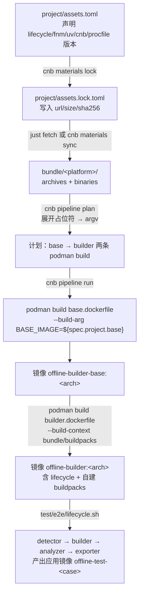
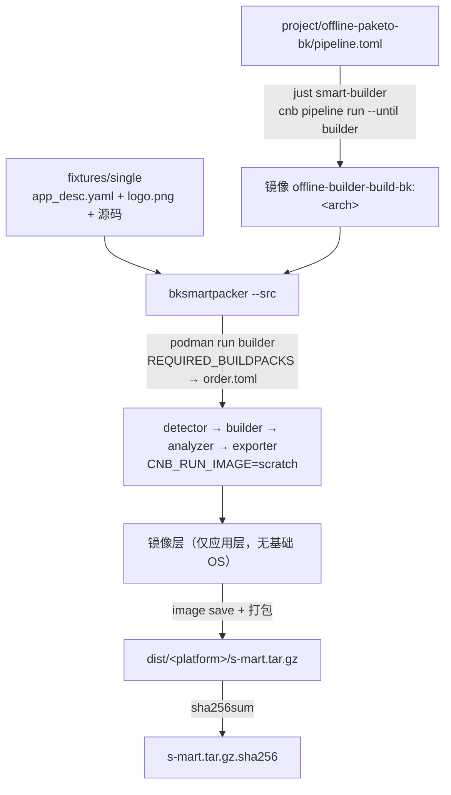

# 架构与执行流程

本文是**当前实现**的架构总览与两条案例，不描述历史方案。执行细节见 [pipeline.md](pipeline.md)，数据流与失败归属见 [build-chain.md](build-chain.md)。

## 1. 分层

```
┌─────────────────────────────────────────────────────────────┐
│ 配置层  project/<name>/pipeline.toml                         │
│         stages（argv 列表）+ spec.checks + [spec.project]     │
├─────────────────────────────────────────────────────────────┤
│ 物料层  project/assets.toml → project/assets.lock.toml → bundle/<platform>/   │
│         cnb materials lock / sync / verify                    │
├─────────────────────────────────────────────────────────────┤
│ 工具层  cnb（Go）                                             │
│         pipeline plan/run · materials · lint · variables · init│
├─────────────────────────────────────────────────────────────┤
│ 运行时  podman / docker                                       │
│         lifecycle（detector/builder/analyzer/exporter）       │
└─────────────────────────────────────────────────────────────┘
```

| 层 | 事实来源 | 谁维护 |
|---|---|---|
| 配置 | `project/*/pipeline.toml` | 人（项目根的基准） |
| 物料 | `project/assets.toml`（版本/URL）+ `project/assets.lock.toml`（哈希） | 人写声明，工具算哈希（物料根的基准） |
| 工具 | `script/tools/cnb` | 代码 + `just tools` |
| 运行时 | 容器 CLI + builder 镜像内的 lifecycle | 镜像构建时固定 |

`cnb` 不解析容器命令行语义：它只做占位符展开与顺序执行，**stage 的 argv 原样交给 execve**。

路径链条（详见 [pipeline.md](pipeline.md#1-路径链条project--assets--bundle)）：
`pipeline.toml` --(`assets`)--> `assets.toml` --(`[bundle].path`)--> `bundle/`。

## 2. 案例 A：offline-paketo（纯离线 builder）

目标：产出一个可离线使用的 CNB builder 镜像。



| 步骤 a → b | 工具 | 用了什么功能 | 效果 |
|---|---|---|---|
| project/assets.toml → project/assets.lock.toml | `cnb materials lock` | 下载归档并计算 sha256/size，回填 lock | 版本可复现，哈希入库 |
| lock → bundle/ | `cnb materials sync`（`just fetch`） | 按 lock 下载、解包、写 marker；三态幂等 | 离线物料落盘，断了可重跑 |
| bundle + 配置 → 计划 | `cnb pipeline plan` | 占位符展开（`${spec.project.base}` 等）、路径绝对化 | 打印最终 argv，可审阅 |
| 计划 → 镜像 | `cnb pipeline run` | 按 stages 顺序执行 argv | 产出 base 与 builder 镜像 |
| builder → 应用镜像 | `test/e2e/lifecycle.sh` | 在容器内跑四阶段 | 验证 builder 可离线构建应用 |

## 3. 案例 B：offline-paketo-bk（蓝鲸 SmartPackage）

目标：产出蓝鲸侧的 `s-mart.tar.gz`（只含应用层）。



| 步骤 a → b | 工具 | 用了什么功能 | 效果 |
|---|---|---|---|
| 配置 → builder 镜像 | `cnb pipeline run --until builder` | 只执行到 builder stage | 复用同一套 plan，跳过打包 |
| builder + 夹具 → 容器构建 | `bksmartpacker --src` | 读 `app_desc.yaml`、生成 order、注入 `REQUIRED_BUILDPACKS` | 一次运行完成四阶段 |
| 构建结果 → 层归档 | bksmartpacker 内部 `image save` | 导出镜像层，`CNB_RUN_IMAGE=scratch` | 产物只含应用层 |
| 层归档 → s-mart | bksmartpacker 打包 | 生成 `.Version` + 层 tar | 蓝鲸可直接消费 |
| s-mart → 校验和 | `sha256sum`（just 里） | 记录哈希 | 发布时可校验 |

## 4. 两条案例的差异

| 维度 | offline-paketo | offline-paketo-bk |
|---|---|---|
| 产物 | builder 镜像 | `s-mart.tar.gz`（层） |
| 构建入口 | `just build` | `just smart` |
| 运行镜像 | `debian:trixie-slim` | `scratch`（只导出层） |
| buildpacks 来源 | `--build-context buildpacks`（builder.dockerfile 有 10 条 COPY） | 同左，另加 BK 契约 |
| 应用侧契约 | CNB 标准 | `app_desc.yaml` + `REQUIRED_BUILDPACKS` |
| 校验 | `cnb lint` + e2e 四阶段 | `bksmartpacker --inspect` + sha256 |

## 5. 命令与效果

完整命令列表与执行语义见 [pipeline.md](pipeline.md#5-常用命令)，本文不再重复。

## 6. 边界

| 不做 | 原因 |
|---|---|
| 解析容器命令行 | argv 就是事实，解析会漂移 |
| 为检查给 stage 加类型 | 会破坏"列表顺序即执行" |
| 维护手写脚手架模板 | 会与真实项目漂移（现改为复制参考项目） |
