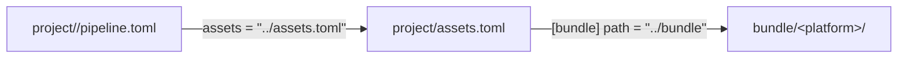
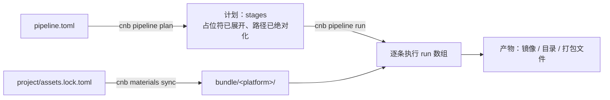

# 流水线执行细节

本文讲**一条配置如何被执行**。架构与两条案例见 [architecture.md](architecture.md)。

## 1. 路径链条（project → assets → bundle）

三层配置，两跳相对引用，每跳以**自己的文件所在目录**为锚点：



| 跳 | 声明 | 锚点 | 解析结果（本项目） |
|---|---|---|---|
| project → assets | `[spec.project] assets` | `pipeline.toml` 所在目录 | `project/offline-paketo/../assets.toml` → `project/assets.toml` |
| assets → bundle | `[bundle] path` | `assets.toml` 所在目录 | `project/../bundle` → `bundle/` |

只有落地后才变绝对路径。因此：

- 项目目录可整体搬移（`../assets.toml` 相对位置不变即可）
- 物料清单可单独搬移（`../bundle` 相对位置不变即可）

| 输入 | 位置 | 归属 |
|---|---|---|
| 流水线配置 | `project/<name>/pipeline.toml` | 项目根 |
| 物料声明 | `project/assets.toml` | 物料根 |
| 物料锁 | `project/assets.lock.toml` | 物料根 |
| 物料目录 | `bundle/<platform>/` | 由物料根的 `[bundle].path` 决定 |

**两个根，界线明确**：

| 根 | 定义 | 谁相对它解析 |
|---|---|---|
| 项目根 | `pipeline.toml` 所在目录 | `workdir`、`spec.checks.path`、项目内路径 |
| 物料根 | `assets.toml` 所在目录 | `[bundle].path`、本地 `source` |

跨项目的共享资源（`bundle/`、`buildpacks/`）只用 `${runtime.bundle}` /
`${runtime.repo}` 这类绝对路径占位符引用，不用相对路径。

覆盖顺序（配置 → 命令行）：

| 目标 | 配置 | 命令行/环境 |
|---|---|---|
| 用哪份清单 | `[spec.project] assets` | `--file` > `LOCK_FILE` |
| 物料落哪 | `[bundle].path` | `--bundle` |
| 共享资源根 | —（只能显式） | `--repo` > `CNB_REPO_ROOT` > 标记文件发现 |

## 2. 执行链路



`plan` 与 `run` 是同一套展开逻辑：`run` 等于 `plan` 之后逐条执行。

## 3. stage 的结构

```toml
[[spec.stages]]
name        = "builder"
description = "构建 builder 镜像（lifecycle + buildpacks）"
workdir     = "project/offline-paketo"
run = [
  "podman", "build", "-f", "docker/builder.dockerfile",
  "-t", "offline-builder:${derived.architecture}",
  "--build-context", "bundle=${runtime.bundle}",
  ".",
]
```

| 字段 | 语义 |
|---|---|
| `name` | 阶段名，`--from/--until` 用它定位 |
| `description` | 仅展示，不参与执行 |
| `workdir` | 命令执行目录（相对**配置文件所在目录**，执行前绝对化） |
| `run` | argv，`run[0]` 是命令，其余是参数 |
| `env` | 追加环境变量（可选） |
| `timeout` | 单阶段超时（可选，默认 10m）；超时后进程被 kill |
| `continueOnError` | 失败后是否继续后续 stage（可选）；**整体仍以 exit 1 结束** |

**没有类型分派**：每个 stage 只有一条命令，执行器不解释命令内容。

失败语义（已实测）：

- 默认：任一 stage 失败 → 立即停止，exit 1，后续 stage 不执行
- `continueOnError = true`：失败后继续执行后续 stage，结束时汇总为 `N stage(s) failed`，exit 1
- `timeout` 到点：进程被 kill，日志 `stage failed … signal: killed`

## 4. 占位符

`run` 与 `spec.checks` 共用一套变量，命名就是配置路径：

| 占位符 | 含义 |
|---|---|
| `${spec.project.platform}` | 目标平台 |
| `${runtime.project}` | 项目目录（`pipeline.toml` 所在目录） |
| `${runtime.materials}` | 物料清单目录（`assets.toml` 所在目录） |
| `${spec.project.base}` | 当前平台的基础镜像 |
| `${spec.assets.<id>.version}` | 物料版本（缺省取 lock） |
| `${derived.architecture}` | `amd64` / `arm64` |
| `${derived.container_platform}` | `linux/amd64` |
| `${runtime.repo}` | 工作区根（`--repo`/发现，绝对路径） |
| `${runtime.bundle}` | 物料目录（绝对路径） |

未知占位符在 plan 阶段直接报错；`cnb pipeline variables <profile>` 可查看解析值。

## 5. 常用命令

```bash
# 只看计划（不执行）
just --justfile project/offline-paketo/justfile plan

# 执行全部 stage
just --justfile project/offline-paketo/justfile build

# 只跑某一段（调试用）
cnb pipeline run project/offline-paketo/pipeline.toml --until builder
cnb pipeline run project/offline-paketo/pipeline.toml --from builder
cnb pipeline run project/offline-paketo/pipeline.toml --dry-run

# 静态检查
cnb pipeline profile validate project/offline-paketo/pipeline.toml
cnb lint project/offline-paketo/pipeline.toml
```

## 6. 校验分三层

| 层 | 命令 | 查什么 |
|---|---|---|
| 结构 | `cnb pipeline profile validate` | 字段必填、stage 非空、平台合法 |
| 静态 | `cnb lint` | 构建参数、脚本存在、Dockerfile COPY 源 |
| 物料 | `cnb materials verify` | 归档哈希、解压产物 |

`just check` 覆盖前两层与 lock 结构；`just verify` 校验物料落盘。

## 7. 改东西去哪

| 想改 | 改哪里 |
|---|---|
| 升物料版本 | `project/assets.toml` 的 `version` |
| 某项目锁版本 | `pipeline.toml` 的 `[spec.assets.<id>] version` |
| 换基础镜像 | `[spec.project.base]` |
| 加一个构建步骤 | 加一条 `[[spec.stages]]` |
| 调顺序 | 移动 stage 位置 |
| 换平台 | `--platform` 或 `[spec.project] platform` |
| 换容器命令 | `run[0]`（默认 podman） |

## 8. 约定

1. **物料版本只写在 `project/assets.toml`**，配置里用 `${spec.assets.<id>.version}` 引用。
2. **stage 的 argv 原样执行**，工具不做 shell 解析、不注入额外参数。
3. **静态检查信息写在 `spec.checks`**，不要为检查给 stage 加类型。
