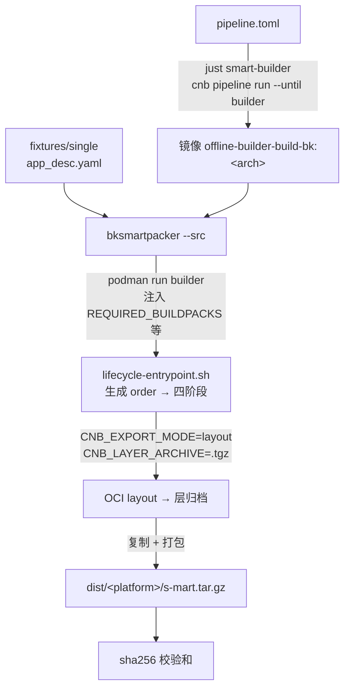

# offline-paketo-bk 架构说明

> 本文描述 `project/offline-paketo-bk` 的**当前实现**。
> 仓库级架构见 [`docs/design/architecture.md`](../../../docs/design/architecture.md)，
> 需求与验收见 [`requirements.md`](requirements.md)，
> 与 offline-paketo 的差异见 [`delta-from-paketo.md`](delta-from-paketo.md)。

## 一、定位

在 `offline-paketo`（纯 CNB 离线构建）之上增加蓝鲸平台契约：
builder 镜像内的入口脚本读取 `bksmartpacker` 注入的环境变量，
一次运行完成 detect → build → analyze → export，导出时 run 镜像为 `scratch`，
产物只含应用层，由 bksmartpacker 打包成 `s-mart.tar.gz`。

## 二、目录

```
project/offline-paketo-bk/
├── pipeline.toml                  # 流水线：base / builder 两条 stage
├── justfile                       # build / plan / fetch / verify / smart / pack-case
├── docker/
│   ├── builder-base.dockerfile    # 系统依赖层
│   ├── builder-build.dockerfile   # lifecycle + 自研 buildpack
│   ├── lifecycle-entrypoint.sh    # 转交 cnb lifecycle run（编排在 Go）
│   ├── order.toml                 # 默认 detect 顺序
│   └── apt-sources/
├── fixtures/
│   ├── single/                    # BK 结构：app_desc.yaml + logo.png + 源码
│   └── multi/                     # 多模块
├── dist/<platform>/               # s-mart.tar.gz 与 .sha256（不入库）
└── docs/
```

buildpack 组件在仓库级 `buildpacks/paketo/`，通过
`--build-context buildpacks=<repo>/buildpacks/paketo` 提供给 builder 构建。

## 三、执行流程



常用命令：

```bash
just plan                 # 打印两条 stage 的最终 argv
just build                # 只构建镜像
just fetch                # 同步物料
just smart                # 全链路：镜像 + bksmartpacker 打包 + 校验
just smart /path/to/app   # 打包任意 BK 应用目录
just pack-case /path/app  # 复用已有 builder，只打包
```

## 四、镜像

| stage | Dockerfile | 产物 tag | 内容 |
|---|---|---|---|
| base | `docker/builder-base.dockerfile` | `offline-builder-base-bk:<arch>` | 系统包、apt 源、locale |
| builder | `docker/builder-build.dockerfile` | `offline-builder-build-bk:<arch>` | lifecycle、cnb、jq/yq/pack、自研 buildpack |

与 offline-paketo 的命名差异（只做加法）：本项目 Dockerfile 使用
`builder-base` / `builder-build` 后缀，不改其他项目的文件名。

## 五、BK 契约

`docker/lifecycle-entrypoint.sh` 只是转交控制权：

```sh
exec /cnb/tools/cnb lifecycle run "$@"
```

真正的编排在 Go（`cnb lifecycle run`）：

1. 读平台环境变量（`SOURCE_GET_URL` / `REQUIRED_BUILDPACKS` / `OUTPUT_IMAGE` …）
2. 按 `REQUIRED_BUILDPACKS` 生成 `order.toml`，名称映射到本仓库组件
3. 依次执行 detector / builder / analyzer / exporter
4. `CNB_RUN_IMAGE=scratch` 使导出只含应用层

| 变量 | 含义 |
|---|---|
| `SOURCE_GET_URL` | 源码包地址（`file:///tmp/source.tgz`） |
| `REQUIRED_BUILDPACKS` | 参与构建的组件列表 |
| `OUTPUT_IMAGE` | 导出目标镜像 |
| `CNB_RUN_IMAGE` | 运行镜像（本项目固定 `scratch`） |
| `CACHE_IMAGE` | 可选缓存镜像 |

## 五·一、为什么还需要 bksmartpacker

`cnb` 能导出 OCI layout、也能把 layout 转 docker-archive，但它只解决**单个模块的镜像**。
`bksmartpacker` 解决的是**蓝鲸交付契约与多模块编排**，两者不重叠：

| 能力 | cnb / lifecycle | bksmartpacker |
|---|---|---|
| 读 `app_desc.yaml`、拆分模块 | ❌ | ✅ |
| 准备每个模块的源码包（含 Procfile/artifact.json） | ❌ | ✅ |
| 启动 builder 容器、注入 `SOURCE_GET_URL` 等契约 | ❌ | ✅ |
| detect → build → analyze → export | ✅ | 调用方 |
| 收集 `logo.png` / `.Version` 标记 | ❌ | ✅ |
| 打包 `s-mart.tar.gz`（层 tgz + 元数据） | ❌ | ✅ |
| 缓存镜像（`CACHE_IMAGE`）推送/拉取 | ❌ | ✅ |

导出默认走 **OCI layout + 层归档**：容器内 exporter 写 layout，
`cnb` 再把镜像目录打包为 `<module>.tgz`（`CNB_LAYER_ARCHIVE`），
bksmartpacker 直接复制该文件进 s-mart。`BKS_EXPORT_MODE=daemon` 时才退回
`image save`（仅真 dockerd 适用）。

其中**不可替代**的是：

1. **s-mart 结构**：`app_desc.yaml`、`.Version = cnb-image-layers`、`<module>.tgz`（docker-save 格式）——由 BK 平台约定，`cnb` 不实现。
2. **多模块编排**：一个 `app_desc.yaml` 可能有 web/worker 多个模块，每个模块各自构建并导出。
3. **缓存镜像**：跨构建复用 `/layers/cache` 的载体是镜像，需要工具负责 push/pull。

`cnb` 在其中的位置是"容器内的构建器"：builder 镜像里的 `cnb lifecycle run`
负责跑四阶段并把镜像交给 exporter；外层调度仍由 bksmartpacker 完成。

## 六、物料与运行时

- 物料来自仓库根 `assets.toml` / `assets.lock.toml`，`cnb materials sync` 落到 `bundle/`
- 首次构建需要网络（Go SDK、Node、Python 由各自 buildpack 下载）；有 `/layers/cache` 后离线
- 可选挂载运行时（不打包进镜像）：

```bash
CNB_RUNTIMES=/opt/cnb-runtimes just smart
CNB_CACHE_DIR=/var/cache/bk just smart
```

## 七、已知限制

| 限制 | 说明 |
|---|---|
| 首次构建联网 | 组件按"挂载运行时 → `/layers/cache` → 镜像源"取用，缓存为空时需要网络 |
| 单架构 | 镜像与产物按 `<arch>` 区分，跨架构分别构建 |
| 依赖 bksmartpacker | 打包与 `s-mart` 结构由外部工具决定，本仓库不实现 |
| 产物不入库 | `dist/` 为构建输出 |

## 八、历史

变更记录见 [`docs/archive/offline-paketo-bk-history.md`](../../../docs/archive/offline-paketo-bk-history.md)，
pack 时代的流程见 [`docs/archive/bk-build-logic.md`](../../../docs/archive/bk-build-logic.md)。

## 九、managed pind 离线 runtime

builder 镜像不包含 daemon。managed pind 使用独立 sidecar 镜像：

```text
bundle/<platform>/images/runtime-pind.tar
bundle/<platform>/images/runtime-pind.tar.sha256
```

### 生产 bundle

```bash
just runtime-pind-bundle
```

这会：

1. 构建 `offline-runtime-pind-bk:<arch>`
2. 导出 OCI archive 到 bundle
3. 写入 sha256

该步骤是离线包的生产者，可能使用 apt 网络。

### 消费 bundle

```bash
RUNTIME=pind \
BKS_RUNTIME_DRIVER=managed \
CNB_RUNTIME_IMAGE=offline-runtime-pind-bk:<arch> \
CNB_RUNTIME_WORKSPACE=/var/lib/cnb/run \
bksmartpacker ...
```

pipeline 的 `runtime-pind` stage 只做：

```text
校验 sha256
podman load -i bundle/<platform>/images/runtime-pind.tar
```

不会在消费端访问 apt 或网络。


### runtime-pind 静态二进制

runtime-pind 不再通过 apt 安装 podman，而是从 bundle 中的静态包构建：

```text
bundle/<platform>/binaries/podman-static/6.2.1/podman-linux-amd64.tar.gz
```

来源：

```text
https://github.com/mgoltzsche/podman-static/releases/download/v6.2.1/podman-linux-amd64.tar.gz
```

该包包含静态 podman、crun、runc、conmon、fuse-overlayfs、netavark、pasta 等依赖。

生产：

```bash
just podman-static
just runtime-pind-bundle
```

消费：

```bash
just smart-runtime
```

构建 runtime 镜像时不再访问 apt 或外网；只从 bundle 复制静态包。


### managed runtime 缓存

runtime sidecar 的 storage 不再放在 `/cnb/work/runtime`，而是使用 podman 命名卷：

```text
cnb-runtime-podman
  → /cnb/runtime
  → /cnb/runtime/podman/storage
  → /cnb/runtime/podman/runroot
```

没有卷或 cache 时使用 `/tmp/cnb-runtime` 临时目录，不写入 `/cnb/work`，也不保证跨构建复用。


### runtime storage 卷与清理

managed sidecar 的 runtime storage 使用 podman 管理的命名卷：

```text
cnb-runtime-podman
cnb-runtime-docker
```

挂载到 sidecar：

```text
/cnb/runtime
```

实际 storage：

```text
/cnb/runtime/podman/storage
/cnb/runtime/podman/runroot
```

这样避免 rootless 宿主下 cache 目录属主变成 subuid 后无法管理。

清理：

```bash
podman volume rm -f cnb-runtime-podman
```

卷默认跨构建保留；只有需要彻底重置 runtime cache 时才删除。
